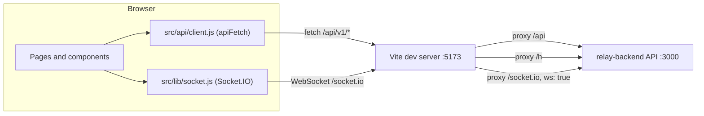

<div align="center">

# RELAY Frontend

**The web app for RELAY, a hosted, multi-tenant webhook gateway.**
Capture every request, inspect it live, forward it with signed deliveries, and replay it when something breaks.

[](https://github.com/parthgupta21/relay-frontend/actions/workflows/ci.yml)
[](https://react.dev)
[](https://vite.dev)
[](https://tailwindcss.com)
[](https://ui.shadcn.com)

</div>

---

## Contents

- [Overview](#overview)
- [Features](#features)
- [How it talks to the backend](#how-it-talks-to-the-backend)
- [Production image](#production-image)
- [Tech stack](#tech-stack)
- [Project structure](#project-structure)
- [Quick start](#quick-start)
- [Scripts](#scripts)
- [Design system](#design-system)
- [Accessibility](#accessibility)
- [Security notes](#security-notes)
- [Known limitations](#known-limitations)
- [Roadmap](#roadmap)
- [Related](#related)

## Overview

A user creates an **endpoint** and gets a public URL. Every HTTP request sent to that URL is captured byte for byte and shown in an **inspector**. The user can then add **destinations**, and RELAY forwards each captured event to them as signed HTTP requests with automatic retries. Every delivery has an attempt timeline, and any event or delivery can be **replayed**.

This repo is the browser app only. The API, worker, MySQL and Redis live in [relay-backend](https://github.com/parthgupta21/relay-backend).

## Features

### Accounts

- Register, email verification, resend verification, log in, log out.
- Forgot password and reset password flows. Passwords require at least 10 characters.
- `/app/*` routes sit behind `RequireAuth`. A `401` from `/auth/me` redirects to `/login` and returns the user to the page they asked for.
- A banner asks unverified users to verify their email before creating endpoints.

### Endpoints

- Endpoint cards show name, status, public URL (with copy), events in the last 24 hours and creation date.
- Create an endpoint with a name and an optional idempotency header (for example `x-github-delivery`). Requests that repeat that header's value are captured once.
- Usage shows as "N of max endpoints used", from the workspace limits returned by `/auth/me`, plus a usage meter in the sidebar.

### Inspector

- Tabs per endpoint: **Events**, **Destinations**, **Settings**.
- Event list with method filter (`GET`, `POST`, `PUT`, `PATCH`, `DELETE`), cursor-based "Load more" and a manual refresh.
- "Live" indicator while the socket is connected, "Reconnecting" otherwise.
- Two-pane layout at `lg` (1024 px) and up. Below that, each row links to its own event page.
- Event detail: method and path, received time, size, content type, source IP and idempotency key.
- Body viewer with **Pretty** (highlighted JSON, when the body parses as JSON), **Raw** (UTF-8) and **Hex** (first 4 KB) views, plus copy and download.
- Headers and query parameters as key/value tables.
- Settings: rename, change the idempotency header, enable or disable the endpoint, rotate the slug, delete. Destructive actions go through a confirm dialog.

### Destinations and deliveries

- Add, edit, enable, disable and delete destinations: name, URL, timeout (1,000 to 30,000 ms) and custom headers.
- The signing secret is shown once, on create or rotate, in a dialog with a copy button.
- Validation errors from the API (`422` with `details`) show under the URL field.
- Each event lists its deliveries with status, attempt count, last HTTP status and a `manual` tag for replays.
- Delivery page: status, attempt count (or "attempt N of max" when the API sends `maxAttempts`), last HTTP status, a link to the original when it is a replay, a live countdown to the next retry, and a readable failure reason (`non_retryable`, `exhausted`, `ssrf_blocked`, `destination_disabled`).
- Attempt timeline: outcome, HTTP status, duration, start time, error message, and a collapsible response with headers and body.

### Replay

- Replay a single delivery. The app opens the new delivery when it is queued.
- Replay an event to selected destinations. Active destinations are preselected.
- Every replay call sends a fresh `Idempotency-Key` (`crypto.randomUUID()`).
- A `429 RATE_LIMITED` response (the hourly replay limit) shows the toast "Replay limit reached, try again later".

### Usage

- `/app/usage` shows events this month and today against the plan limits, delivery attempts for both periods (each retry counts), the per-endpoint requests-per-minute limit, and a bar chart of the last 31 days (UTC) with an accessible table behind it.
- An alert appears when the monthly or daily event limit is reached.
- A `503` from `/usage` (Redis not ready) shows "Usage is temporarily unavailable" with a Retry button.
- The sidebar shows the same monthly meter next to the endpoint meter.

### Analytics

- `/app/analytics` shows delivery statistics for 24 hours or 7 days, for all endpoints or one: deliveries, success rate, failed count, and p50 and p95 attempt latency.
- A stacked bar chart of deliveries created per hour or per day (succeeded, failed, in progress), breakdowns of failure reasons and attempt outcomes, and a per-destination table that marks soft-deleted destinations.
- States for loading, no deliveries in the window, and errors with a Retry button. A note shows the workspace retention, because older deliveries are purged.

### API tokens

- `/app/settings/tokens` lists tokens (name, prefix, created, last used, expires) and marks expired ones.
- Create a token with a name and an expiry of never, 7, 30, 90 or 365 days. The token is shown once, in a dialog with a copy button and a `curl` example. Creating is disabled until the email is verified.
- Revoke a token after a confirm dialog.

### Account

- `/app/settings/account` shows email, verification status, workspace ID and the plan limits.
- Delete account: needs the password and the account email typed to confirm. On success the app returns to the landing page. A wrong password shows under the field. Operators cannot delete their account (the API answers `403`).

### Admin

Visible only when `/auth/me` reports `isOperator`. `RequireOperator` renders the not-found page for everyone else, and the sidebar shows an "Admin" item to operators.

- `/app/admin`: workspace list with a debounced search by owner email prefix, a status filter (active, suspended, deleted) and cursor-based "Load more".
- `/app/admin/workspaces/:id`: owner, role, counts (endpoints, destinations, API tokens), usage meters, an editable limits form (only changed fields are sent, with the API's ranges as input bounds), recent audit rows, suspend or reactivate, and delete (the owner email must be typed to confirm). The status button is hidden for the operator's own workspace. The delete section is hidden for deleted workspaces and for operators.
- `/app/admin/audit`: audit log with filters for action and workspace ID, and cursor-based "Load more". An unknown workspace ID shows "No workspace with that ID."

### Suspended workspace

When `/auth/me` answers `403`, `RequireAuth` shows a "Workspace suspended" screen with a Sign out button instead of the app. The backend answers `403` on every authenticated route for a suspended or deleted workspace.

### Landing page

- Public page at `/` with hero, an animated mock inspector, "How it works", feature grid, and `curl` and signature-verification code samples.
- The signature sample matches the backend signer: header `X-Relay-Signature: t=<unix>,v1=<hex>`, HMAC-SHA256 over `<t>.<raw body>`.
- Calls to action switch between "Get started free" and "Open dashboard" based on the session.

## How it talks to the backend



The proxy rules live in [`vite.config.js`](vite.config.js). In production, nginx does the same job. See [Production image](#production-image).

**Cookie sessions.** `apiFetch` sends every request with `credentials: 'include'`. The dev proxy keeps the app and the API on one origin, so the session cookie is same-origin. The client uses relative URLs only (`/api/v1/...` and `io()` with no URL), so a deployed build expects the API on the same origin. The nginx image provides that.

**Error envelope.** Every non-2xx response is read as:

```json
{
  "error": {
    "code": "...",
    "message": "...",
    "details": [],
    "requestId": "..."
  }
}
```

`apiFetch` throws an `ApiError` with `status`, `code`, `message`, `details` and `requestId`. `ErrorMessage` shows the message, and adds the request ID for `5xx` errors. A `204` returns `null`.

**Live updates.** One shared Socket.IO connection is created on first use with `withCredentials`, and closed on sign-out.

| Server event       | Payload                           | What the app does                                                                       |
| ------------------ | --------------------------------- | --------------------------------------------------------------------------------------- |
| `event.created`    | `{ endpointId, eventId }`         | The inspector fetches new events for the open endpoint.                                 |
| `delivery.updated` | `{ deliveryId, eventId, status }` | The delivery page reloads its delivery. The event panel reloads when `eventId` matches. |

Polling stays as a fallback: every 5 s while the socket is disconnected and every 30 s while connected, because the backend does not push sweeper and replay transitions yet.

## Production image

The `Dockerfile` builds the app with `node:22-slim` (`npm ci`, `npm run build`) and copies `dist/` into `nginx:1.27-alpine`. [`nginx/default.conf.template`](nginx/default.conf.template) is rendered at container start. `NGINX_ENVSUBST_FILTER=^RELAY_` limits template substitution to `RELAY_*` variables, so nginx's own variables are left alone.

| Variable                | Default              | Purpose                              |
| ----------------------- | -------------------- | ------------------------------------ |
| `RELAY_API_UPSTREAM`    | `http://api:3000`    | Target of `/api/` and `/socket.io/`. |
| `RELAY_INGEST_UPSTREAM` | `http://ingest:3000` | Target of `/h/`.                     |

What the config does:

- **Routing.** `/` serves the single-page app and falls back to `index.html`. `/assets/` is served from disk and returns `404` when a file is missing.
- **Proxies.** `/api/` goes to the API upstream with a 128 KB body limit. `/h/` goes to the ingest upstream with a 10 MB body limit. `/socket.io/` goes to the API upstream with the WebSocket upgrade headers and a one-hour read timeout.
- **Docker DNS re-resolution.** The upstreams are variables in `proxy_pass`, and `resolver 127.0.0.11 valid=10s` points at Docker's DNS. nginx re-resolves the names every 10 seconds, so it keeps working when the `api` or `ingest` container gets a new address, and it starts even if they are not up yet.
- **Client address.** `X-Forwarded-For` is set to the connection's remote address, which replaces any value the client sent. `X-Forwarded-Proto` is `https` when the incoming request already says `https`, otherwise the connection's own scheme. A TLS terminator in front of nginx can therefore make the backend see HTTPS, which the `Secure` session cookie needs.
- **Content-Security-Policy.** `default-src 'self'; connect-src 'self' ws://<host> wss://<host>; img-src 'self' data:; style-src 'self' 'unsafe-inline'; base-uri 'self'; form-action 'self'; frame-ancestors 'none'`. `<host>` is the request's `Host` header, kept only if it matches `[A-Za-z0-9.:-]+`, so the WebSocket origin follows the host the page was loaded from. The theme script is the external `/theme.js`, so no inline script is needed. nginx also sends `X-Content-Type-Options: nosniff` and `Referrer-Policy: strict-origin-when-cross-origin`.
- **Caching.** `/assets/` gets `public, max-age=31536000, immutable`. Other static files get `no-cache`. Proxied paths get no `Cache-Control` from nginx.
- **Compression.** `gzip` for CSS, JavaScript, JSON and SVG.
- **Masked access log.** The logged path is the URI without the query string, and `/h/<slug>` is cut to its first 6 characters followed by `...`.
- `server_tokens off` hides the nginx version.

The container listens on port 80 and does not terminate TLS. The production stack is defined in `docker-compose.prod.yml` in [relay-backend](https://github.com/parthgupta21/relay-backend), which publishes only this container.

CI builds the image on every push and pull request (`docker` job). `.github/workflows/deploy.yml` runs on `workflow_dispatch` and on `v*` tags. A `gate` job skips the build unless the secrets `DEPLOY_HOST`, `DEPLOY_USER` and `DEPLOY_SSH_KEY` exist. Otherwise it pushes `ghcr.io/<owner>/relay-frontend` tagged with the commit SHA and `latest`. The workflow does not connect to the server. The backend's compose file pulls the image.

## Tech stack

| Area       | Choice                                                                             | Why                                                                                                   |
| ---------- | ---------------------------------------------------------------------------------- | ----------------------------------------------------------------------------------------------------- |
| Build      | [Vite](https://vite.dev) 8                                                         | Dev server with the `/api`, `/h` and `/socket.io` proxy, so cookies stay same-origin.                 |
| UI         | [React](https://react.dev) 19, JavaScript (JSX)                                    | JSX, not TypeScript, by project decision. shadcn is configured with `"tsx": false`.                   |
| Routing    | [React Router](https://reactrouter.com) 7 (`react-router-dom`)                     | Public, auth and `/app/*` routes. Old `/endpoints...` and `/events/:id` paths redirect to `/app/...`. |
| State      | React state and `src/api/client.js`                                                | No state library. One fetch wrapper with a typed `ApiError`.                                          |
| Styling    | [Tailwind CSS](https://tailwindcss.com) v4 via `@tailwindcss/vite`                 | Semantic CSS-variable tokens in `src/index.css`, no Tailwind config file.                             |
| Components | [shadcn/ui](https://ui.shadcn.com) (new-york) on [Radix](https://www.radix-ui.com) | Accessible primitives copied into `src/components/ui`.                                                |
| Icons      | [lucide-react](https://lucide.dev)                                                 | Icon library set in `components.json`.                                                                |
| Motion     | [motion](https://motion.dev)                                                       | Inspector row entry and landing animations, with `MotionConfig reducedMotion="user"`.                 |
| Toasts     | [sonner](https://sonner.emilkowal.ski)                                             | Success and error feedback, themed from the same tokens.                                              |
| Realtime   | [socket.io-client](https://socket.io) 4                                            | Push updates, with polling kept as a fallback.                                                        |
| Fonts      | Geist Sans and Geist Mono (`@fontsource-variable`)                                 | Self-hosted variable fonts.                                                                           |
| Lint       | [oxlint](https://oxc.rs)                                                           | What the current Vite template ships, instead of ESLint.                                              |

## Project structure

```text
src/
├── main.jsx                 # Entry: mounts <App />, loads theme
├── App.jsx                  # Routes, MotionConfig, TooltipProvider, Toaster
├── index.css                # Tailwind v4, design tokens, fonts
├── api/
│   ├── client.js            # apiFetch and ApiError
│   ├── auth.js
│   ├── endpoints.js
│   ├── events.js
│   ├── destinations.js
│   ├── deliveries.js
│   ├── tokens.js
│   ├── usage.js
│   ├── analytics.js
│   ├── account.js
│   └── admin.js
├── components/
│   ├── AppLayout.jsx        # App shell, sign-out, mobile Sheet menu
│   ├── Sidebar.jsx          # Nav, usage meter, user menu
│   ├── RequireAuth.jsx      # Session gate for /app/*, suspended screen
│   ├── RequireOperator.jsx  # Operator gate for /app/admin/*
│   ├── DestinationsPanel.jsx
│   ├── ReplayDialog.jsx
│   ├── SecretDialog.jsx     # Show-once secret (signing secret, API token)
│   ├── UsageMeter.jsx
│   ├── ConfirmDialog.jsx
│   ├── CodeBlock.jsx        # Code sample and JSON highlighter
│   ├── StatusBadge.jsx
│   ├── MethodBadge.jsx
│   ├── ErrorMessage.jsx
│   ├── AuthCard.jsx
│   ├── CopyButton.jsx
│   ├── EmptyState.jsx
│   ├── Logo.jsx
│   ├── PageHeader.jsx
│   ├── ResendForm.jsx
│   ├── SiteHeader.jsx
│   ├── SiteFooter.jsx
│   ├── ThemeToggle.jsx
│   ├── VerifyBanner.jsx
│   └── ui/                  # 16 shadcn/ui components (button, dialog, tabs, ...)
├── hooks/
│   ├── useMe.js             # Current user and workspace
│   ├── usePolling.js        # Interval fallback
│   ├── useRealtime.js       # useRealtimeEvent, useRealtimeConnected
│   └── useTheme.js          # System or user-chosen theme
├── lib/
│   ├── socket.js            # Shared lazy Socket.IO client
│   └── utils.js             # cn, timeAgo, formatBytes
└── pages/
    ├── Landing.jsx
    ├── Register.jsx
    ├── CheckInbox.jsx
    ├── Verify.jsx
    ├── Login.jsx
    ├── ForgotPassword.jsx
    ├── ResetPassword.jsx
    ├── Endpoints.jsx
    ├── EndpointInspector.jsx
    ├── EventDetail.jsx      # Also exports EventPanel
    ├── DeliveryDetail.jsx
    ├── Usage.jsx
    ├── Analytics.jsx
    ├── ApiTokens.jsx
    ├── Account.jsx
    ├── AdminWorkspaces.jsx
    ├── AdminWorkspace.jsx
    ├── AdminAudit.jsx
    └── NotFound.jsx

nginx/default.conf.template   # Production nginx config
public/                       # favicon.svg and theme.js (served as-is)
Dockerfile                    # Vite build, then nginx image
```

The `@` import alias points to `src` (`vite.config.js`, `jsconfig.json`).

## Quick start

**Prerequisites**

- Node.js `^20.19.0` or `>=22.12.0` (required by Vite 8 and oxlint).
- [relay-backend](https://github.com/parthgupta21/relay-backend) running on `http://localhost:3000`, with `APP_BASE_URL=http://localhost:5173` so email links point at this app.

**Run**

```bash
git clone https://github.com/parthgupta21/relay-frontend.git
cd relay-frontend
npm install
npm run dev
```

Open [http://localhost:5173](http://localhost:5173). No frontend environment variables are needed: the dev server proxies `/api`, `/h` and `/socket.io` to port 3000.

**Before you push**

```bash
npm run build
npm run lint
```

CI runs the same build and lint. See [CONTRIBUTING.md](CONTRIBUTING.md) for the workflow.

## Scripts

| Script            | Command        | Purpose                                                         |
| ----------------- | -------------- | --------------------------------------------------------------- |
| `npm run dev`     | `vite`         | Start the dev server on port 5173 with the backend proxy.       |
| `npm run build`   | `vite build`   | Production build into `dist/`.                                  |
| `npm run lint`    | `oxlint`       | Lint with oxlint (`react` and `oxc` plugins, `.oxlintrc.json`). |
| `npm run preview` | `vite preview` | Serve the built `dist/` locally.                                |

## Design system

- **Type.** Geist Sans for UI text and Geist Mono for URLs, payloads, IDs and code.
- **Color.** Zinc neutrals with one violet accent, exposed as `brand` and `brand-text`.
- **Semantic tokens.** `success`, `warning`, `info` and `destructive`, defined as OKLCH CSS variables in `src/index.css` with a light set on `:root` and a dark set on `.dark`. Status badges and JSON highlighting use these tokens only.
- **Theme.** Built dark-first, with full light and dark token sets. The theme follows the system color scheme until the user toggles it. The choice is saved in `localStorage` under `relay-theme`, with reads and writes wrapped in try/catch, and applied as a `dark` class on `<html>`.
- **Motion.** `MotionConfig reducedMotion="user"` wraps the app, so animations respect the OS reduced-motion setting.
- **Layout.** Fixed sidebar at `lg` and up. Below that, the sidebar opens in a slide-in sheet.

## Accessibility

What the code does today:

- Built on Radix primitives (dialogs, menus, tabs, select, switch, tooltip) through shadcn/ui.
- Form inputs have associated `<label>` elements. Icon-only buttons have an `aria-label`.
- The destination URL field sets `aria-invalid` and `aria-describedby` when the API rejects it.
- The sidebar usage meter is a `role="progressbar"` with min, max and current values.
- The verify-email banner uses `role="status"`. The selected inspector row sets `aria-current`.
- The usage and analytics charts are `aria-hidden`, with a visually hidden table carrying the same numbers.
- A visible `:focus-visible` outline uses the ring token.
- The decorative landing mock inspector is `aria-hidden`.

No automated accessibility audit has been run.

## Security notes

- **Payloads render as text.** Bodies, headers, query values and response bodies go through React text nodes. The JSON highlighter builds `<span>` elements from regex matches. The codebase does not use `dangerouslySetInnerHTML`.
- **Session in cookies.** Auth relies on the backend session cookie (`credentials: 'include'`). The app stores no tokens. The only `localStorage` key is the theme.
- **Secrets shown once.** A destination's signing secret appears only in the dialog after create or rotate. It is removed from the list state.
- **Replay idempotency.** Each replay request carries a new `Idempotency-Key`.
- **Request IDs.** Server errors show the `requestId` so a failure can be traced in backend logs.

## Known limitations

- No automated frontend tests yet.
- The UI has been checked by build, lint, dev-server fetches and a smoke test of the production stack. It has not been clicked through in a real browser. In particular, the CSP and the Socket.IO connection through nginx have not been checked in a real browser.
- No refetch on socket reconnect. Events missed while disconnected appear on the next fallback poll (inspector, delivery page) or on reload (event page).
- The event panel refreshes only on `delivery.updated` pushes, so sweeper and replay transitions there show after a reload.
- The landing page is static marketing content. Its `curl` sample uses the placeholder host `relay.dev`.
- The production image serves plain HTTP. Behind plain HTTP, login fails with `500` because the backend's session cookie is `Secure`. Terminate TLS in front of nginx and send `X-Forwarded-Proto: https`.
- nginx's error log can include an ingest slug on upstream errors. The access log is masked, the error log is not.
- A browser `OPTIONS` preflight to an ingest URL is captured as an event by the backend, because ingest sends no CORS headers.

The backend's own limitations are listed in its [README](https://github.com/parthgupta21/relay-backend#known-limitations).

## Roadmap

- [x] **Phase 1: Capture and inspector.** Auth pages, endpoints, inspector, event detail.
- [x] **Phase 2: Forwarding.** Destinations, delivery timeline, landing page, design system.
- [x] **Phase 3: Reliability.** Retry states and countdown, delivery and event replay.
- [x] **Phase 4: Realtime and analytics.**
  - [x] Socket.IO live updates with polling fallback.
  - [x] Analytics page.
- [x] **Phase 5: Tokens, usage and account pages.**
  - [x] API tokens, usage and account pages, with account deletion.
  - [x] Operator admin screens and the suspended-workspace screen.
- [x] **Phase 6: Launch.**
  - [x] nginx production image with a strict CSP, proxies and masked access log.
  - [x] GHCR deploy workflow.

## Related

- [relay-backend](https://github.com/parthgupta21/relay-backend): Koa API, delivery worker, MySQL and Redis. Includes the full API reference and signature verification guide.

---

<div align="center">

Copyright (c) 2026 Parth Gupta. All rights reserved.

</div>
