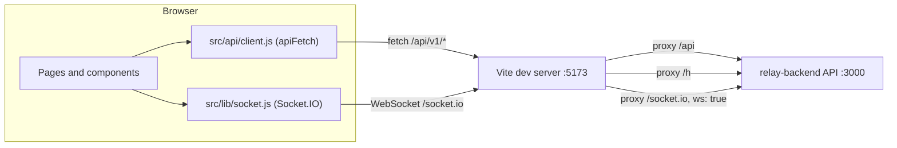

<div align="center">

# RELAY Frontend

**The web app for RELAY, a hosted, multi-tenant webhook gateway.**
Capture every request, inspect it live, forward it with signed deliveries, and replay it when something breaks.

[](https://github.com/parthgupta21/relay-frontend/actions/workflows/ci.yml)
[](https://react.dev)
[](https://vite.dev)
[](https://tailwindcss.com)
[](https://ui.shadcn.com)

</div>

---

## Contents

- [Overview](#overview)
- [Features](#features)
- [How it talks to the backend](#how-it-talks-to-the-backend)
- [Tech stack](#tech-stack)
- [Project structure](#project-structure)
- [Quick start](#quick-start)
- [Scripts](#scripts)
- [Design system](#design-system)
- [Accessibility](#accessibility)
- [Security notes](#security-notes)
- [Known limitations](#known-limitations)
- [Roadmap](#roadmap)
- [Related](#related)

## Overview

A user creates an **endpoint** and gets a public URL. Every HTTP request sent to that URL is captured byte for byte and shown in an **inspector**. The user can then add **destinations**, and RELAY forwards each captured event to them as signed HTTP requests with automatic retries. Every delivery has an attempt timeline, and any event or delivery can be **replayed**.

This repo is the browser app only. The API, worker, MySQL and Redis live in [relay-backend](https://github.com/parthgupta21/relay-backend).

## Features

### Accounts

- Register, email verification, resend verification, log in, log out.
- Forgot password and reset password flows. Passwords require at least 10 characters.
- `/app/*` routes sit behind `RequireAuth`. A `401` from `/auth/me` redirects to `/login` and returns the user to the page they asked for.
- A banner asks unverified users to verify their email before creating endpoints.

### Endpoints

- Endpoint cards show name, status, public URL (with copy), events in the last 24 hours and creation date.
- Create an endpoint with a name and an optional idempotency header (for example `x-github-delivery`). Requests that repeat that header's value are captured once.
- Usage shows as "N of max endpoints used", from the workspace limits returned by `/auth/me`, plus a usage meter in the sidebar.

### Inspector

- Tabs per endpoint: **Events**, **Destinations**, **Settings**.
- Event list with method filter (`GET`, `POST`, `PUT`, `PATCH`, `DELETE`), cursor-based "Load more" and a manual refresh.
- "Live" indicator while the socket is connected, "Reconnecting" otherwise.
- Two-pane layout at `lg` (1024 px) and up. Below that, each row links to its own event page.
- Event detail: method and path, received time, size, content type, source IP and idempotency key.
- Body viewer with **Pretty** (highlighted JSON, when the body parses as JSON), **Raw** (UTF-8) and **Hex** (first 4 KB) views, plus copy and download.
- Headers and query parameters as key/value tables.
- Settings: rename, change the idempotency header, enable or disable the endpoint, rotate the slug, delete. Destructive actions go through a confirm dialog.

### Destinations and deliveries

- Add, edit, enable, disable and delete destinations: name, URL, timeout (1,000 to 30,000 ms) and custom headers.
- The signing secret is shown once, on create or rotate, in a dialog with a copy button.
- Validation errors from the API (`422` with `details`) show under the URL field.
- Each event lists its deliveries with status, attempt count, last HTTP status and a `manual` tag for replays.
- Delivery page: status, attempt count (or "attempt N of max" when the API sends `maxAttempts`), last HTTP status, a link to the original when it is a replay, a live countdown to the next retry, and a readable failure reason (`non_retryable`, `exhausted`, `ssrf_blocked`, `destination_disabled`).
- Attempt timeline: outcome, HTTP status, duration, start time, error message, and a collapsible response with headers and body.

### Replay

- Replay a single delivery. The app opens the new delivery when it is queued.
- Replay an event to selected destinations. Active destinations are preselected.
- Every replay call sends a fresh `Idempotency-Key` (`crypto.randomUUID()`).
- A `429 QUOTA_EXCEEDED` response shows the toast "Replay limit reached, try again later".

### Landing page

- Public page at `/` with hero, an animated mock inspector, "How it works", feature grid, and `curl` and signature-verification code samples.
- The signature sample matches the backend signer: header `X-Relay-Signature: t=<unix>,v1=<hex>`, HMAC-SHA256 over `<t>.<raw body>`.
- Calls to action switch between "Get started free" and "Open dashboard" based on the session.

## How it talks to the backend



The proxy rules live in [`vite.config.js`](vite.config.js).

**Cookie sessions.** `apiFetch` sends every request with `credentials: 'include'`. The dev proxy keeps the app and the API on one origin, so the session cookie is same-origin. The client uses relative URLs only (`/api/v1/...` and `io()` with no URL), so a deployed build expects the API on the same origin.

**Error envelope.** Every non-2xx response is read as:

```json
{ "error": { "code": "...", "message": "...", "details": [], "requestId": "..." } }
```

`apiFetch` throws an `ApiError` with `status`, `code`, `message`, `details` and `requestId`. `ErrorMessage` shows the message, and adds the request ID for `5xx` errors. A `204` returns `null`.

**Live updates.** One shared Socket.IO connection is created on first use with `withCredentials`, and closed on sign-out.

| Server event | Payload | What the app does |
| --- | --- | --- |
| `event.created` | `{ endpointId, eventId }` | The inspector fetches new events for the open endpoint. |
| `delivery.updated` | `{ deliveryId, eventId, status }` | The delivery page reloads its delivery. The event panel reloads when `eventId` matches. |

Polling stays as a fallback: every 5 s while the socket is disconnected and every 30 s while connected, because the backend does not push sweeper and replay transitions yet.

## Tech stack

| Area | Choice | Why |
| --- | --- | --- |
| Build | [Vite](https://vite.dev) 8 | Dev server with the `/api`, `/h` and `/socket.io` proxy, so cookies stay same-origin. |
| UI | [React](https://react.dev) 19, JavaScript (JSX) | JSX, not TypeScript, by project decision. shadcn is configured with `"tsx": false`. |
| Routing | [React Router](https://reactrouter.com) 7 (`react-router-dom`) | Public, auth and `/app/*` routes. Old `/endpoints...` and `/events/:id` paths redirect to `/app/...`. |
| State | React state and `src/api/client.js` | No state library. One fetch wrapper with a typed `ApiError`. |
| Styling | [Tailwind CSS](https://tailwindcss.com) v4 via `@tailwindcss/vite` | Semantic CSS-variable tokens in `src/index.css`, no Tailwind config file. |
| Components | [shadcn/ui](https://ui.shadcn.com) (new-york) on [Radix](https://www.radix-ui.com) | Accessible primitives copied into `src/components/ui`. |
| Icons | [lucide-react](https://lucide.dev) | Icon library set in `components.json`. |
| Motion | [motion](https://motion.dev) | Inspector row entry and landing animations, with `MotionConfig reducedMotion="user"`. |
| Toasts | [sonner](https://sonner.emilkowal.ski) | Success and error feedback, themed from the same tokens. |
| Realtime | [socket.io-client](https://socket.io) 4 | Push updates, with polling kept as a fallback. |
| Fonts | Geist Sans and Geist Mono (`@fontsource-variable`) | Self-hosted variable fonts. |
| Lint | [oxlint](https://oxc.rs) | What the current Vite template ships, instead of ESLint. |

## Project structure

```text
src/
├── main.jsx                 # Entry: mounts <App />, loads theme
├── App.jsx                  # Routes, MotionConfig, TooltipProvider, Toaster
├── index.css                # Tailwind v4, design tokens, fonts
├── api/
│   ├── client.js            # apiFetch and ApiError
│   ├── auth.js
│   ├── endpoints.js
│   ├── events.js
│   ├── destinations.js
│   └── deliveries.js
├── components/
│   ├── AppLayout.jsx        # App shell, sign-out, mobile Sheet menu
│   ├── Sidebar.jsx          # Nav, usage meter, user menu
│   ├── RequireAuth.jsx      # Session gate for /app/*
│   ├── DestinationsPanel.jsx
│   ├── ReplayDialog.jsx
│   ├── ConfirmDialog.jsx
│   ├── CodeBlock.jsx        # Code sample and JSON highlighter
│   ├── StatusBadge.jsx
│   ├── MethodBadge.jsx
│   ├── ErrorMessage.jsx
│   ├── AuthCard.jsx
│   ├── CopyButton.jsx
│   ├── EmptyState.jsx
│   ├── Logo.jsx
│   ├── PageHeader.jsx
│   ├── ResendForm.jsx
│   ├── SiteHeader.jsx
│   ├── SiteFooter.jsx
│   ├── ThemeToggle.jsx
│   ├── VerifyBanner.jsx
│   └── ui/                  # 20 shadcn/ui components (button, dialog, tabs, ...)
├── hooks/
│   ├── useMe.js             # Current user and workspace
│   ├── usePolling.js        # Interval fallback
│   ├── useRealtime.js       # useRealtimeEvent, useRealtimeConnected
│   └── useTheme.js          # System or user-chosen theme
├── lib/
│   ├── socket.js            # Shared lazy Socket.IO client
│   └── utils.js             # cn, timeAgo, formatBytes
└── pages/
    ├── Landing.jsx
    ├── Register.jsx
    ├── CheckInbox.jsx
    ├── Verify.jsx
    ├── Login.jsx
    ├── ForgotPassword.jsx
    ├── ResetPassword.jsx
    ├── Endpoints.jsx
    ├── EndpointInspector.jsx
    ├── EventDetail.jsx      # Also exports EventPanel
    ├── DeliveryDetail.jsx
    └── NotFound.jsx
```

The `@` import alias points to `src` (`vite.config.js`, `jsconfig.json`).

## Quick start

**Prerequisites**

- Node.js `^20.19.0` or `>=22.12.0` (required by Vite 8 and oxlint).
- [relay-backend](https://github.com/parthgupta21/relay-backend) running on `http://localhost:3000`, with `APP_BASE_URL=http://localhost:5173` so email links point at this app.

**Run**

```bash
git clone https://github.com/parthgupta21/relay-frontend.git
cd relay-frontend
npm install
npm run dev
```

Open [http://localhost:5173](http://localhost:5173). No frontend environment variables are needed: the dev server proxies `/api`, `/h` and `/socket.io` to port 3000.

**Before you push**

```bash
npm run build
npm run lint
```

CI runs the same build and lint. See [CONTRIBUTING.md](CONTRIBUTING.md) for the workflow.

## Scripts

| Script | Command | Purpose |
| --- | --- | --- |
| `npm run dev` | `vite` | Start the dev server on port 5173 with the backend proxy. |
| `npm run build` | `vite build` | Production build into `dist/`. |
| `npm run lint` | `oxlint` | Lint with oxlint (`react` and `oxc` plugins, `.oxlintrc.json`). |
| `npm run preview` | `vite preview` | Serve the built `dist/` locally. |

## Design system

- **Type.** Geist Sans for UI text and Geist Mono for URLs, payloads, IDs and code.
- **Color.** Zinc neutrals with one violet accent, exposed as `brand` and `brand-text`.
- **Semantic tokens.** `success`, `warning`, `info` and `destructive`, defined as OKLCH CSS variables in `src/index.css` with a light set on `:root` and a dark set on `.dark`. Status badges and JSON highlighting use these tokens only.
- **Theme.** Built dark-first, with full light and dark token sets. The theme follows the system color scheme until the user toggles it. The choice is saved in `localStorage` under `relay-theme`, with reads and writes wrapped in try/catch, and applied as a `dark` class on `<html>`.
- **Motion.** `MotionConfig reducedMotion="user"` wraps the app, so animations respect the OS reduced-motion setting.
- **Layout.** Fixed sidebar at `lg` and up. Below that, the sidebar opens in a slide-in sheet.

## Accessibility

What the code does today:

- Built on Radix primitives (dialogs, menus, tabs, select, switch, tooltip) through shadcn/ui.
- Form inputs have associated `<label>` elements. Icon-only buttons have an `aria-label`.
- The destination URL field sets `aria-invalid` and `aria-describedby` when the API rejects it.
- The sidebar usage meter is a `role="progressbar"` with min, max and current values.
- The verify-email banner uses `role="status"`. The selected inspector row sets `aria-current`.
- Unavailable nav items ("Soon") are marked `aria-disabled`.
- A visible `:focus-visible` outline uses the ring token.
- The decorative landing mock inspector is `aria-hidden`.

No automated accessibility audit has been run.

## Security notes

- **Payloads render as text.** Bodies, headers, query values and response bodies go through React text nodes. The JSON highlighter builds `<span>` elements from regex matches. The codebase does not use `dangerouslySetInnerHTML`.
- **Session in cookies.** Auth relies on the backend session cookie (`credentials: 'include'`). The app stores no tokens. The only `localStorage` key is the theme.
- **Secrets shown once.** A destination's signing secret appears only in the dialog after create or rotate. It is removed from the list state.
- **Replay idempotency.** Each replay request carries a new `Idempotency-Key`.
- **Request IDs.** Server errors show the `requestId` so a failure can be traced in backend logs.

## Known limitations

- No automated frontend tests yet.
- The UI has been checked by build, lint and dev-server fetches. It has not been fully clicked through in a real browser.
- The Socket.IO client has not been run against the live backend yet.
- No refetch on socket reconnect. Events missed while disconnected appear on the next fallback poll (inspector, delivery page) or on reload (event page).
- The event panel refreshes only on `delivery.updated` pushes, so sweeper and replay transitions there show after a reload.
- The landing page is static marketing content. Its `curl` sample uses the placeholder host `relay.dev`.

## Roadmap

- [x] **Phase 1: Capture and inspector.** Auth pages, endpoints, inspector, event detail.
- [x] **Phase 2: Forwarding.** Destinations, delivery timeline, landing page, design system.
- [x] **Phase 3: Reliability.** Retry states and countdown, delivery and event replay.
- [ ] **Phase 4: Realtime and analytics.**
  - [x] Stage A: Socket.IO live updates with polling fallback.
  - [ ] Analytics charts.
- [ ] **Phase 5: Tokens, usage and account pages.**
- [ ] **Phase 6: Launch.**

## Related

- [relay-backend](https://github.com/parthgupta21/relay-backend): Koa API, delivery worker, MySQL and Redis. Includes the full API reference and signature verification guide.

---

<div align="center">

Copyright (c) 2026 Parth Gupta. All rights reserved.

</div>
